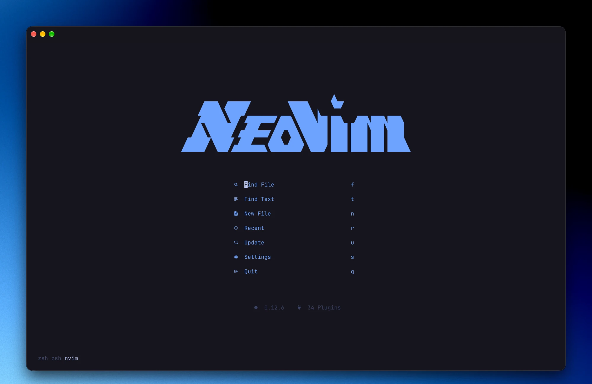
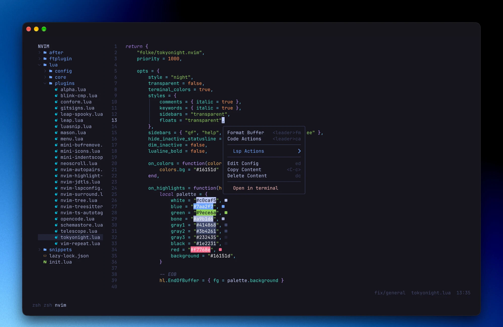

# nvim

Personal Neovim configuration, managed with [Dotbot](https://github.com/anishathalye/dotbot). The config lives under `nvim/` and is symlinked into `~/.config/nvim` by `./install`. Plugins are managed with [lazy.nvim](https://github.com/folke/lazy.nvim), which bootstraps itself on first launch.

## Showcase



*Startup dashboard.*



*Right-click context menu.*

## Structure

```bash
.
├── .dotbot/            # Dotbot (git submodule)
├── .install.conf.yaml  # Dotbot config: which file links where
├── install             # Entry point: syncs submodules, runs Dotbot
├── LICENSE
├── docs/               # Keymap reference and screenshots
└── nvim/               # The Neovim config, linked to ~/.config/nvim
```

## Config

```bash
nvim/
├── init.lua            # Leader keys, then loads the core modules
├── ftplugin/           # Per-filetype settings (C++, Java)
├── after/ftplugin/     # Overrides loaded after runtime ftplugins (conf, gitconfig)
├── snippets/           # VSCode-style snippets: cpp, java, javascript, lua, python, typescript
└── lua/
    ├── core/           # autocmds, filetypes, keymaps, options, plugins (lazy.nvim bootstrap), statusline
    ├── config/nvmenu/  # Right-click and Ctrl-t context menu: items and UI
    └── plugins/        # One spec file per plugin, auto-loaded by lazy.nvim
```

## Plugins

| Area | Plugins |
| --- | --- |
| Colorscheme | tokyonight |
| LSP | nvim-lspconfig, mason, mason-lspconfig, mason-tool-installer, nvim-jdtls, schemastore |
| Completion and snippets | blink.cmp, LuaSnip |
| Formatting | conform.nvim (stylua, prettier, yamlfmt, clang-format; trailing whitespace trimmed on save) |
| Syntax | nvim-treesitter, nvim-ts-autotag, nvim-highlight-colors |
| Navigation | telescope, nvim-tree, leap (plus leap-spooky) |
| Editing | nvim-surround, nvim-autopairs, vim-repeat |
| UI | alpha, gitsigns, mini.icons, mini.indentscope, mini.bufremove, neoscroll, menu |
| AI | opencode |

## Keymaps

The leader key is `Space`. See [docs/keymaps.md](docs/keymaps.md) for the full list.

## Language servers

Installed through Mason: `html`, `cssls`, `lua_ls`, `pyright`, `jsonls`, `clangd`, `marksman`, `tailwindcss`, `ts_ls`, `bashls`, `astro`, `arduino_language_server`, plus `jdtls` for Java.

## Setup

### Requirements

- Neovim 0.11 or newer (the config uses `vim.lsp.config`)
- `git`, and a C compiler for building Treesitter parsers
- A [Nerd Font](https://www.nerdfonts.com/) for icons. I use JetBrains Mono Nerd Font at size 14
- `node` and `npm` for several Mason packages

### Install

> [!WARNING]
> This config is tailored to my setup and may overwrite your existing `~/.config/nvim`. Use it as a reference and borrow what you need. Install at your own risk.

1. Clone the repo with its submodules:

```bash
git clone --recurse-submodules https://github.com/cyanghxst/nvim.git ~/code/config/nvim
```

2. Move into the repo:

```bash
cd ~/code/config/nvim
```

3. Run the installer:

```bash
./install
```

4. Open Neovim. lazy.nvim installs itself and all plugins on first launch, and Mason installs the language servers and formatters listed above.

## License

This Neovim config is licensed under the [MIT License](LICENSE).
